# New style for sifxtreme.com, three directions

Pick direction 3, the receipt ledger: it is the only one that looks like nothing else on the web, because it shows what already makes the blog his.
Direction 1 is the safest. Direction 2 is the most handsome but says "family site", not "Asif's notes".
All three are static mockups. Nothing is deployed, `global.css` and the live layouts are untouched.

[!ASK] Which direction, and does the seal go on the public site?
- **Pick:** direction 3, with only the owl cropped from the seal as a small mark and sign-off, not the full lettered seal.
- **Why:** the full seal reads "THE AHMED FAMILY" and is unreadable below about 80 px. The owl alone is legible at 36 px and is not a family name.
- **Risk:** any seal image on sifxtreme.com is public. It has been kept out of public repos on purpose. Nothing was copied into the blog repo; the mockups load it from its bifrost path, so they only render on this Mac.
- **Next:** say 1, 2 or 3, and say yes or no to a public owl. Then I build it as a fourth design in `src/designs/` behind the existing `PUBLIC_DESIGN` switch.

## What is unique about sifxtreme today

- **Every post carries a receipt.** Turns, tool calls, redeploys, minutes to live and the model are in each post's front matter (the settings post: 83 turns, 14 redeploys, live after 31 minutes).
- **Every post says how it was written.** Four labels: by hand, dictated, with AI, by AI. Today 4 posts by hand, 11 with AI, 10 by AI, plus a Pangram score on each.
- **A post starts with the question he could not answer.** The `problem:` line is shown at the top, for example "Prevent an old Claude binary from deleting sessions after rejecting settings."
- **Hand-drawn diagrams are the hero of a post,** inline SVG with a `d-*` vocabulary that follows light and dark, not screenshots.
- **It has already been redesigned in public.** The live default is the receipt style, and a post about how Opus 5.5 made it is on the blog. The 776 look would be the second chapter, not a replacement.

## The three directions

His profile photo (`src/assets/asif-head.png`, the one on the live home page) is on every home page: right of the headline in 1, above his name in 2, next to the name in the header in 3 with the owl as the site mark. The live post pages do not show it, so only 3 carries it in the post header.

### 1. 776 clean, family colours

776 structure and type, with the seal's cream, navy and gold. Switzer, headline at -.05em with the full stop in gold, small tracked labels, thin lines, 6px corners, no shadows. The full seal sits small (38 px) in the header.
Best for: quiet and consistent with the rest of his 776 work.
Weak spot: it could be any person's blog. The receipts shrink to a small label.

| Home, 1280 | Home, 390 |
|---|---|
| 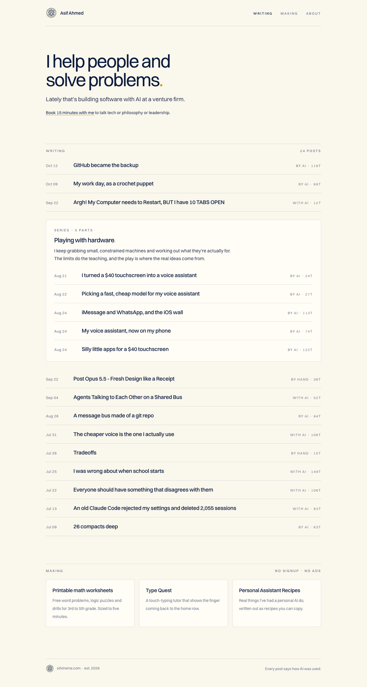 | 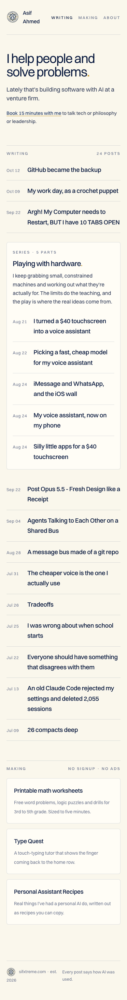 |

| Post, 1280 | Post, 390 |
|---|---|
| 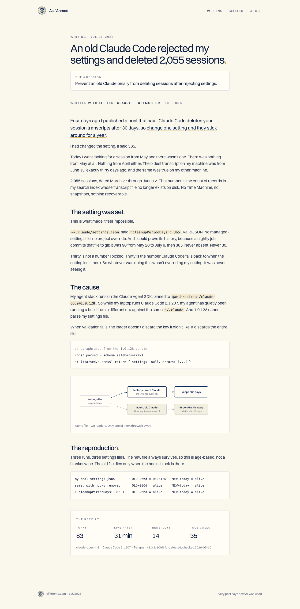 | 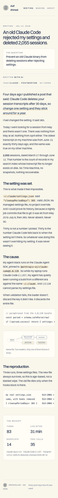 |

### 2. Seal-forward

The full seal at 200 px as the masthead, centred. Navy ink on cream, gold for links, numerals and the full stop, a drop cap, a pull-quote for the question, and a navy footer band with the motto.
Best for: a personal, editorial feel; it is the most distinctive at first sight.
Weak spot: it makes the seal the brand. A family seal on a work-adjacent blog is a bigger claim than a small mark, and the lettering says "The Ahmed Family" in public. The seal already takes the top 400 px of the home page.

| Home, 1280 | Home, 390 |
|---|---|
| 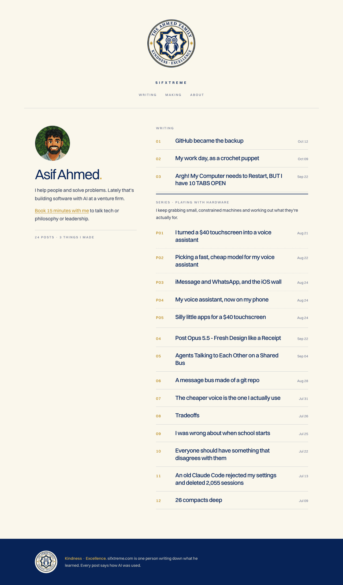 | 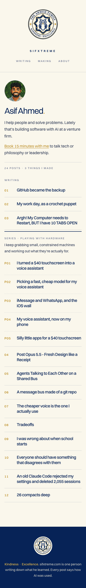 |

| Post, 1280 | Post, 390 |
|---|---|
| 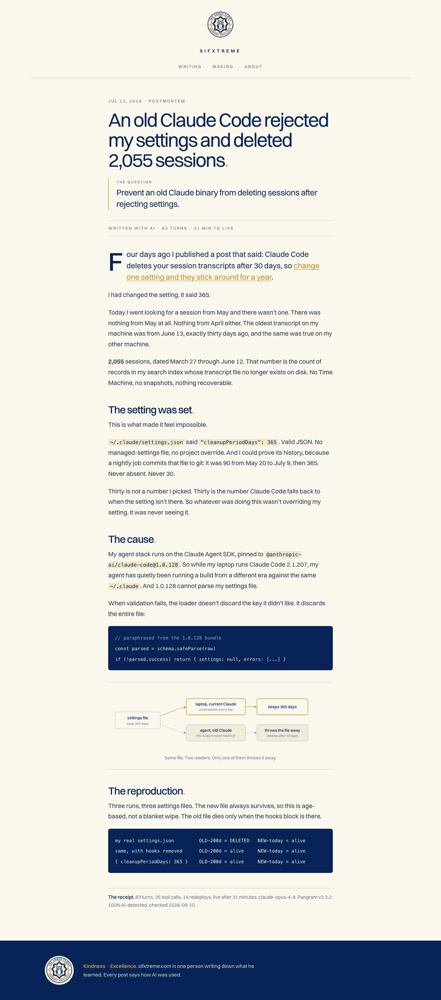 | 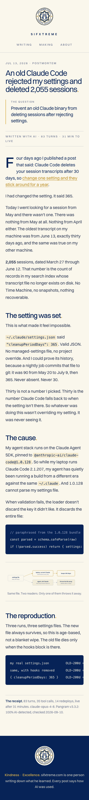 |

### 3. Receipt ledger (my pick)

776 paper, ink and type, with one orange accent kept from today's blog and navy for the owl and for "written by AI". The home page is a ledger: date, title, how it was made, turns. A panel shows how the whole blog was made (1,611 turns; 4 by hand, 11 with AI, 10 by AI). Each post ends with its receipt as dotted-leader lines and a small owl sign-off.
Best for: it turns his real difference into the design, and it modernises the receipt idea without the paper-tape costume.
Weak spot: the owl is the only family element; the colour of the seal is mostly absent. It needs one decision on the orange: keep, or swap to gold.

| Home, 1280 | Home, 390 |
|---|---|
| 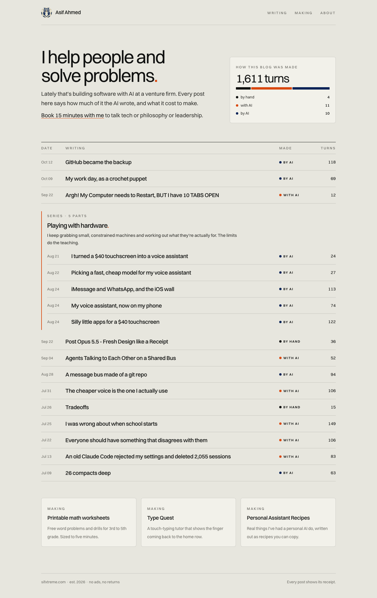 | 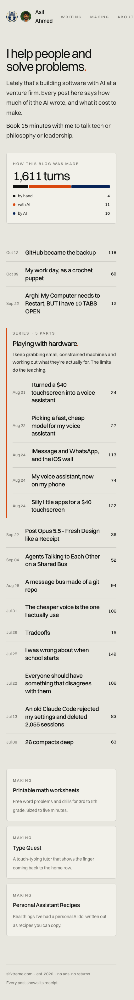 |

| Post, 1280 | Post, 390 |
|---|---|
| 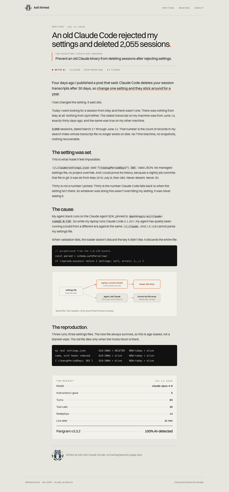 | 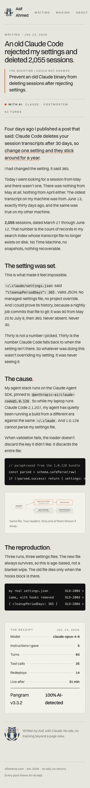 |

:::more
## Not done, and not checked

- Light mode only. No dark mode in any direction yet; the 776 and family palettes both have a dark pair to port.
- The mockups use Switzer from `experiments/visuals/theme/fonts` by file path. Using it on the live site needs the font files in the blog repo; check the Switzer licence first.
- The post is the real settings post, trimmed (one diagram, two code blocks). Long tables, the series nav, share buttons, Copy for LLM and the Pangram badge were not drawn.
- Phone screenshots show no horizontal overflow (page width 390 in all six). I did not test a real phone.
- The seal path: `bifrost family/seal/owl-v2-geometric.png`. Owl crop is CSS only (`background-size` on that image).

Files: `src/designs/2026-11-20-new-style/{1-776-family,2-seal-forward,3-receipt-ledger}/{home,post}.html`, `shared/`, `shots/`.
:::
